# AlieeShop — ER Diagram

The data model is PostgreSQL 18. Two sources define it:

- `server/schema/000_base_schema.sql` — the core tables (`users`, `products`, `category`, `orders`, `cart`, `stock`, …) loaded by `npm run setup`.
- `server/migrations/*.sql` — the additive migrations (`reviews`, `notifications`, `refresh_tokens`, `hero_slides`, …) applied by `npm run migrate`.

This document is a snapshot of the two together. If you change the schema, update the diagram in the same commit.

---

## Diagram

```mermaid
erDiagram
    %% ---------- Identity & access ----------
    roles ||--o{ users : "grants"
    roles ||--o{ role_permissions : "has"
    permissions ||--o{ role_permissions : "assigned to"

    %% ---------- Catalog ----------
    category ||--o{ category : "parent of"
    category ||--o{ products : "classifies"
    products ||--o{ productimages : "has"
    products ||--o{ variants : "has"
    variantattribute ||--o{ variantattributevalue : "has"
    variants ||--o{ variantoptionvalue : "has"
    variantattributevalue ||--o{ variantoptionvalue : "used by"
    products ||--o{ stock : "tracked by"
    variants |o--o{ stock : "tracked by"
    stock ||--o{ stocklog : "logs"
    users |o--o{ stocklog : "records"
    products ||--o{ discounts : "discounted by"
    variants |o--o{ discounts : "discounted by"

    %% ---------- Cart & orders ----------
    users ||--o| cart : "owns"
    cart ||--o{ cartitems : "contains"
    products ||--o{ cartitems : "added as"
    variants |o--o{ cartitems : "added as"
    users ||--o{ orders : "places"
    orders ||--o{ orderitems : "contains"
    products ||--o{ orderitems : "ordered as"
    variants |o--o{ orderitems : "ordered as"
    orders ||--o{ payments : "settled by"
    paymentmethod ||--o{ payments : "paid with"
    discounts |o--o{ payments : "applied to"

    %% ---------- Engagement ----------
    products ||--o{ reviews : "reviewed in"
    users ||--o{ reviews : "writes"
    reviews ||--o{ review_helpful : "voted"
    users ||--o{ review_helpful : "votes"
    users ||--o{ wishlist_items : "saves"
    products ||--o{ wishlist_items : "saved as"
    users ||--o{ refresh_tokens : "sessions"
    users |o--o{ notifications : "receives"

    %% ---------- Configuration (no FKs) ----------
    hero_slides {
        int slide_id PK
        varchar eyebrow
        varchar title
        varchar title_accent
        varchar description
        text image_url
        varchar cta_label
        varchar cta_link
        varchar badge
        int sort_order
        bool is_active
        timestamptz created_at
        timestamptz updated_at
    }

    store_settings {
        varchar setting_key PK
        text setting_value
        timestamptz updated_at
    }

    newsletter_subscribers {
        int subscriberid PK
        varchar email UK
        timestamptz subscribedat
        bool isactive
    }

    audit_log {
        int auditid PK
        varchar action
        varchar entity_type
        int entity_id
        varchar entity_name
        varchar performed_by
        text details
        timestamptz createdat
    }

    schema_migrations {
        varchar filename PK
        timestamptz applied_at
    }

    %% ---------- Identity & access ----------
    roles {
        int rolesid PK
        varchar rolename UK
        varchar description
        int level
        timestamptz createdat
    }

    users {
        int usersid PK
        int rolesid FK
        varchar username UK
        varchar email UK
        varchar firstname
        varchar midname
        varchar lastname
        varchar fullname "generated: first + mid + last"
        varchar passwordhash "bcrypt, app-side only"
        bool isactive
        text profilepictureurl
        timestamptz createdat
        timestamptz updatedat
    }

    permissions {
        int permission_id PK
        varchar permission_key UK
        varchar permission_name
        varchar module
        text description
        varchar type "frontend | backend"
    }

    role_permissions {
        int role_id PK, FK
        int permission_id PK, FK
    }

    %% ---------- Catalog ----------
    category {
        int categoriesid PK
        int parentid FK
        varchar categoryname UK
        timestamptz createdat
    }

    products {
        int productsid PK
        int categoriesid FK
        varchar productname
        numeric baseprice
        text description
        varchar status "active | inactive | archived"
        text_array tags
        timestamptz createdat
        timestamptz updatedat
    }

    productimages {
        int imageid PK
        int productsid FK
        text imageurl "/cdn/images/..."
        varchar alttext
        bool isthumbnail
        int sortorder
        timestamptz createdat
    }

    variants {
        int variantid PK
        int productsid FK
        varchar sku UK
        numeric price "NULL = use product baseprice"
        timestamptz createdat
    }

    variantattribute {
        int attributeid PK
        varchar attributename UK
    }

    variantattributevalue {
        int valueid PK
        int attributeid FK
        varchar value
    }

    variantoptionvalue {
        int variantid PK, FK
        int valueid PK, FK
    }

    stock {
        int stockid PK
        int productsid FK
        int variantid FK
        int quantity
        int minstock
        timestamptz updatedat
    }

    stocklog {
        int logid PK
        int stockid FK
        int usersid FK
        varchar changetype "IN | OUT | ADJUST | RETURN | DAMAGED"
        int quantity
        varchar reason
        timestamptz createdat
    }

    discounts {
        int discountsid PK
        int productsid FK
        int variantid FK
        numeric amounts
        timestamptz startdate
        timestamptz enddate
        timestamptz createdat
    }

    %% ---------- Cart, orders & payments ----------
    cart {
        int cartid PK
        int usersid FK, UK "one cart per user"
        timestamptz createdat
        timestamptz updatedat
    }

    cartitems {
        int cartitemid PK
        int cartid FK
        int productsid FK
        int variantid FK
        int quantity
        timestamptz addedat
    }

    orders {
        int ordersid PK
        int usersid FK
        varchar status "pending | confirmed | shipped | delivered | cancelled"
        numeric totalamount
        timestamptz createdat
        timestamptz updatedat
    }

    orderitems {
        int orderitemid PK
        int ordersid FK
        int productsid FK
        int variantid FK
        int quantity
        numeric unitprice
        numeric subtotal "generated: quantity * unitprice"
        timestamptz createdat
    }

    paymentmethod {
        int methodsid PK
        varchar methodname UK
        varchar description
        bool isactive
        numeric fee "COD fee, default 0.00"
    }

    payments {
        int paymentsid PK
        int ordersid FK
        int methodsid FK
        int discountsid FK
        numeric amount
        varchar status "pending | paid | failed | refunded"
        timestamptz paidat
    }

    %% ---------- Engagement ----------
    reviews {
        int reviewsid PK
        int productsid FK
        int usersid FK
        int rating "1-5"
        varchar title
        text comment
        varchar status "pending | approved | rejected"
        text moderationnote
        timestamptz createdat
        timestamptz updatedat
    }

    review_helpful {
        int helpfulid PK
        int reviewsid FK
        int usersid FK
        timestamptz createdat
    }

    wishlist_items {
        int wishlist_id PK
        int usersid FK
        int productsid FK
        timestamptz createdat
    }

    refresh_tokens {
        int refresh_token_id PK
        int usersid FK
        varchar tokenhash UK "SHA-256 of the token"
        bool rememberme
        timestamptz expiresat
        timestamptz createdat
        timestamptz revokedat
    }

    notifications {
        int notificationid PK
        int userid FK "NULL = broadcast"
        varchar type "order | user | stock | system | product"
        text message
        varchar link
        bool isread
        timestamptz createdat
    }
```



`text_array` is Mermaid's stand-in for PostgreSQL `TEXT[]`; `timestamptz` stands for `TIMESTAMP WITH TIME ZONE`.

GitHub and most IDEs render the block above as-is. To export a viewable image from the repo root:

```bash
npx @mermaid-js/mermaid-cli -i ER_DIAGRAM.md -o er-diagram.svg
# writes er-diagram-1.svg (mermaid-cli numbers the charts it finds in a .md file)
```

---

## Relationships

Cardinality as drawn: `||` = exactly one, `|o` = zero or one, `}o` = zero or many. Every FK has `ON UPDATE CASCADE`; the delete rules below are the ones that differ.

| Parent | Child | Cardinality | `ON DELETE` |
|---|---|---|---|
| `roles` | `users` | 1 : N | `RESTRICT` |
| `roles` | `role_permissions` | 1 : N | `CASCADE` |
| `permissions` | `role_permissions` | 1 : N | `CASCADE` |
| `category` | `category` (`parentid`) | 1 : N, self-referencing | `SET NULL` |
| `category` | `products` | 1 : N | `RESTRICT` |
| `products` | `productimages` | 1 : N | `CASCADE` |
| `products` | `variants` | 1 : N | `RESTRICT` |
| `variantattribute` | `variantattributevalue` | 1 : N | `CASCADE` |
| `variants` | `variantoptionvalue` | 1 : N | `CASCADE` |
| `variantattributevalue` | `variantoptionvalue` | 1 : N | `RESTRICT` |
| `products` | `stock` | 1 : N | `CASCADE` |
| `variants` | `stock` | 0..1 : N | `CASCADE` |
| `stock` | `stocklog` | 1 : N | `RESTRICT` |
| `users` | `stocklog` | 0..1 : N (audit trails survive user deletion) | `SET NULL` |
| `products` | `discounts` | 1 : N | `RESTRICT` |
| `variants` | `discounts` | 0..1 : N | `RESTRICT` |
| `users` | `cart` | 1 : 0..1 (unique `usersid`) | `CASCADE` |
| `cart` | `cartitems` | 1 : N | `CASCADE` |
| `products` | `cartitems` | 1 : N | `CASCADE` |
| `variants` | `cartitems` | 0..1 : N | `SET NULL` |
| `users` | `orders` | 1 : N | `RESTRICT` |
| `orders` | `orderitems` | 1 : N | `CASCADE` |
| `products` | `orderitems` | 1 : N | `RESTRICT` |
| `variants` | `orderitems` | 0..1 : N | `RESTRICT` |
| `orders` | `payments` | 1 : N | `RESTRICT` |
| `paymentmethod` | `payments` | 1 : N | `RESTRICT` |
| `discounts` | `payments` | 0..1 : N | `SET NULL` |
| `products` | `reviews` | 1 : N | `CASCADE` |
| `users` | `reviews` | 1 : N | `CASCADE` |
| `reviews` | `review_helpful` | 1 : N | `CASCADE` |
| `users` | `review_helpful` | 1 : N | `CASCADE` |
| `users` | `wishlist_items` | 1 : N | `CASCADE` |
| `products` | `wishlist_items` | 1 : N | `CASCADE` |
| `users` | `refresh_tokens` | 1 : N | `CASCADE` |
| `users` | `notifications` | 0..1 : N | `CASCADE` |

Uniqueness constraints that shape the model:

- `cart (usersid)` — one cart per user.
- `cartitems (cartid, productsid, variantid)` — adding the same line twice increments the quantity.
- `stock (productsid, variantid)` — one stock row per product/variant pair.
- `reviews (productsid, usersid)` — one review per customer per product.
- `review_helpful (reviewsid, usersid)` — one helpful vote per customer per review.
- `wishlist_items (usersid, productsid)` — a product is saved at most once.
- `variantattributevalue (attributeid, value)` and `variants (sku)`.

`role_permissions`, `variantoptionvalue` and `store_settings` are keyed without a surrogate id: composite PK and natural key respectively.

`audit_log` deliberately has no FK: `performed_by` is a display string so the log survives renames and deletions, and `entity_id` points at any table.

---

## Views

Read-only projections the models query instead of joining by hand:

| View | Purpose |
|---|---|
| `view_products` | Product + category + thumbnail + summed `totalstock`; used by every catalog read (`productModel.js`). |
| `view_users` | User joined to `roles` to expose `rolename`. |
| `view_orders` | Order + customer + payment status/method. |
| `view_order_detail` | Order line items joined to product, variant SKU and customer. |
| `view_cart` | Cart lines joined to product, variant and customer. |
| `view_stock_low` | Active products at or below `minstock`; drives low-stock notifications. |

---

## Tables referenced in code but not created by this repository

These are queried by `server/src/model/` but appear in neither the baseline schema nor any migration, so they only exist on databases where someone created them by hand. They are intentionally left out of the diagram until a migration owns them:

| Table | Referenced from |
|---|---|
| `addresses` | `addressModel.js` / `addressService.js` (`/api/addresses`) |
| `notification_preferences` | `notificationModel.js` |
| `push_subscriptions` | `notificationModel.js` (web push) |

`newsletter_subscribers` is the exception: `newsletterModel.js#ensureTable` creates it lazily on first use, which is why it has no migration but is included above.

---

## Naming conventions

- Column names are lowercase and unquoted: `productsid`, `categoriesid`, `createdat`, `updatedat`. There is no camelCase in the database. Primary-key naming varies — some tables repeat the table name (`reviews.reviewsid`, `roles.rolesid`), others use an `_id` suffix (`hero_slides.slide_id`, `refresh_tokens.refresh_token_id`) — so copy the table's own convention instead of assuming one.
- Table names are mixed: mostly plural (`products`, `orders`, `payments`, `variants`, `reviews`) with singular exceptions (`category`, `cart`, `stock`, `stocklog`, `paymentmethod`). Do not rename existing tables to "fix" this; the models and views depend on the current names.
- Boolean columns are `is`-prefixed: `isactive`, `isthumbnail`, `isread`, `isdefault`.
- Nothing is hashed in the database. `users.passwordhash` holds a bcrypt hash written by `userService.js`; `refresh_tokens.tokenhash` holds a SHA-256 of the opaque token.
