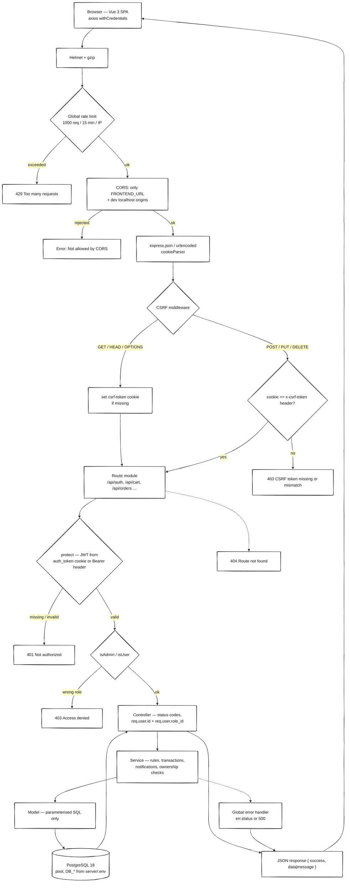
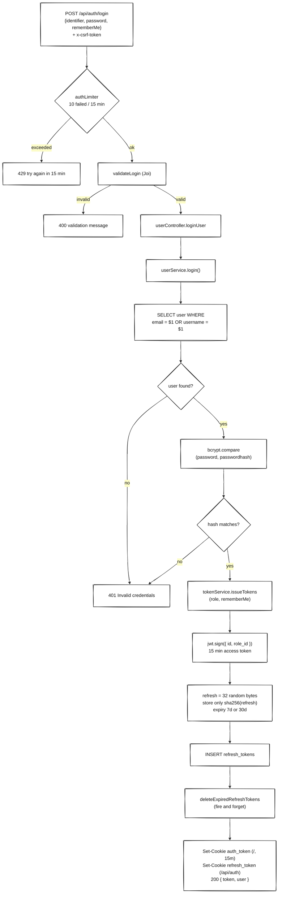
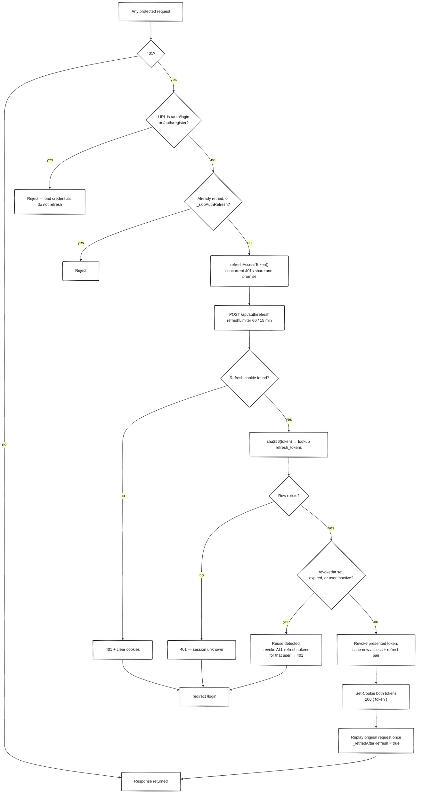
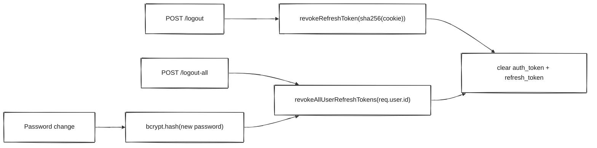
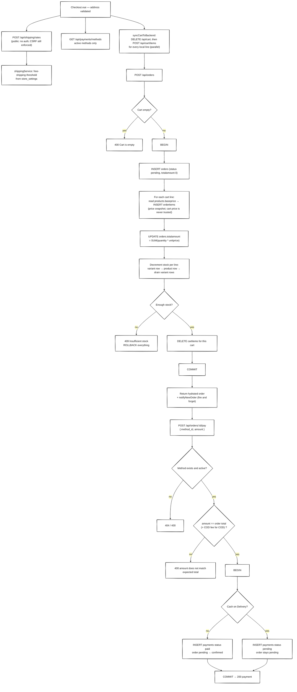
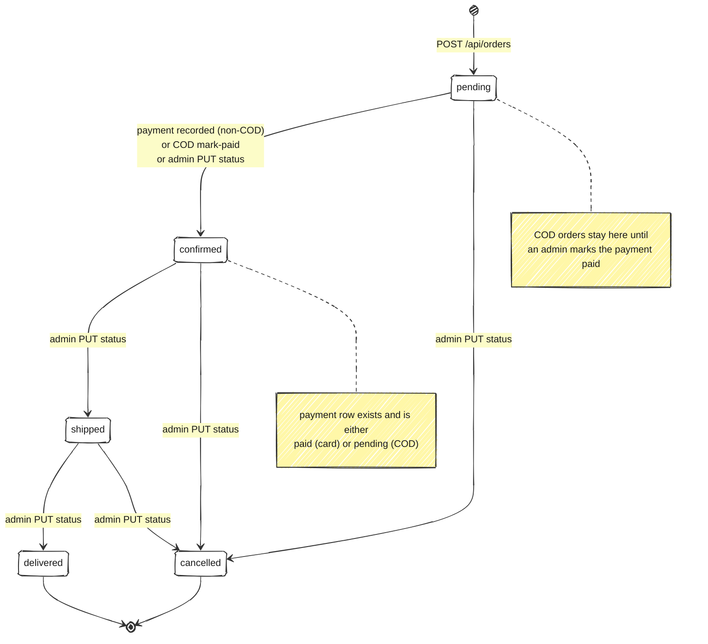
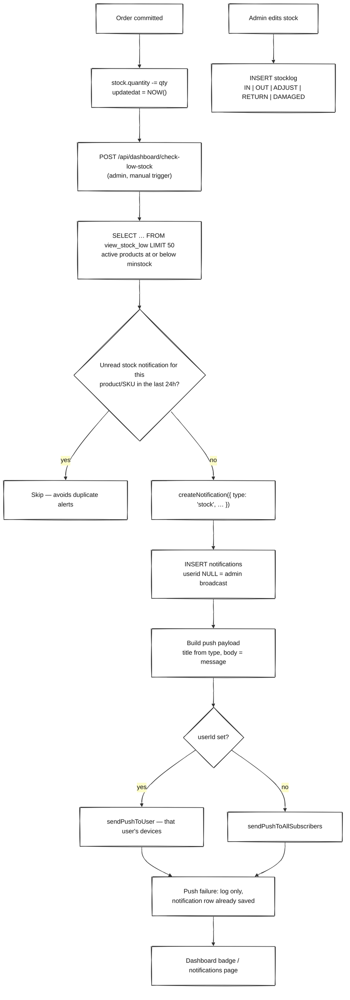

# AlieeShop — Flow Chart

How a request, a session, an order and a stock alert actually travel through the
system. Everything here is traced from the code, not from intent: file references
sit next to each stage so a change can be checked against the diagram.

Companion doc: [ER_DIAGRAM.md](./ER_DIAGRAM.md) for the tables these flows read
and write.

| Flow | Entry point |
|---|---|
| [Request pipeline](#1-request-pipeline) | every call to `/api/*` |
| [Login](#2-login) | `POST /api/auth/login` |
| [Silent session refresh](#3-silent-session-refresh) | `POST /api/auth/refresh` |
| [Logout and revocation](#4-logout-and-revocation) | `/api/auth/logout`, `/logout-all` |
| [Cart → checkout → payment](#5-cart--checkout--payment) | `/checkout` |
| [Order status](#6-order-status) | `PUT /api/orders/:id/status` |
| [Stock and low-stock alerts](#7-stock-and-low-stock-alerts) | `POST /api/dashboard/check-low-stock` |
| [Full journey — one picture](#full-journey--one-picture) | whole app, drawn in the sketch style |

---

## Full journey — one picture

Everything below on a single canvas, in the sketch/whiteboard style of the
reference drawing: white hand-drawn boxes for pages, parallelograms for roles,
diamonds for decisions, stadiums for gates and plain edge labels (`yes`, `no`,
`by default`, `high privilege`).


Pre-rendered above as `FLOW_CHART.png`; the Mermaid source that produces it is
below. The hand-drawn look needs Mermaid 11 or newer — older renderers ignore
the `init` directive and draw plain rectangles, which is why the image is
committed alongside the source.

Regenerate the image after editing that first diagram:

```bash
awk '/^```mermaid$/{f=1;next} /^```$/{if(f){exit}} f' FLOW_CHART.md > /tmp/full.mmd
npx @mermaid-js/mermaid-cli -i /tmp/full.mmd -o FLOW_CHART.png -b "#FCFCC8" -w 4545
```

```mermaid
%%{init: {"look":"handDrawn","handDrawnSeed":11,"theme":"base","themeVariables":{"background":"#FCFCC8","primaryColor":"#FFFFFF","primaryBorderColor":"#333333","primaryTextColor":"#1A1A1A","lineColor":"#333333","secondaryColor":"#FFFFFF","tertiaryColor":"#FFFFFF","edgeLabelBackground":"#FCFCC8","actorBkg":"#FFFFFF","actorBorder":"#333333","actorTextColor":"#1A1A1A","signalColor":"#333333","signalTextColor":"#1A1A1A","noteBkgColor":"#FFF7A8","noteBorderColor":"#333333","noteTextColor":"#1A1A1A","labelBackgroundColor":"#FCFCC8","fontFamily":"Segoe Print, Comic Sans MS, cursive","fontSize":"15px"},"flowchart":{"curve":"basis","nodeSpacing":55,"rankSpacing":70,"padding":24}}}%%
flowchart LR
    visitor(["visitor"])
    home["Main page<br/>(home page)"]
    catalog["Browse store<br/>/product · search · tags"]
    detail["Product detail<br/>/product/:id"]
    cart["Cart<br/>/api/cart"]
    guest["Guest browsing<br/>wishlist · compare · FAQ"]
    gate(["Need account<br/>for purchase?"])
    login["Sign in<br/>/login"]
    signup["Sign up<br/>/register"]
    forgot["Forgot password<br/>/forgotPassword"]
    roles{"role_id"}
    customers[/"customers"/]
    admin[/"admin"/]
    sa[/"Super admin"/]
    checkout["Checkout<br/>/checkout"]
    order["Order placed<br/>POST /api/orders"]
    pay{"payment method"}
    card["Card<br/>payment paid"]
    cod["Cash on delivery<br/>COD fee added"]
    markpaid["Mark COD paid<br/>(admin)"]
    success["Order confirmed<br/>/orderSucces"]
    track["Track order<br/>+ notifications"]
    dashboard["Dashboard<br/>/admin/dashboard"]
    manage["Manage products · stock<br/>orders · users · reviews"]
    status["Update order status<br/>pending to delivered"]
    stock["Low-stock check<br/>/api/dashboard/check-low-stock"]
    notify(["Notification<br/>+ web push"])

    visitor --> home
    home --> catalog
    catalog --> detail
    detail --> cart
    cart --> gate
    gate -- yes --> login
    gate -- no --> guest
    guest --> catalog
    login -- "no account" --> signup
    login --> forgot
    forgot --> login
    login --> roles
    signup --> roles
    roles -- "3 customer (default)" --> customers
    roles -- "2 admin" --> admin
    roles -- "1 high privilege" --> sa
    customers --> checkout
    checkout --> order
    order --> pay
    pay -- card --> card
    pay -- COD --> cod
    card --> success
    cod --> markpaid
    markpaid --> success
    success --> track
    sa --> dashboard
    admin -- "admin APIs only" --> manage
    dashboard --> manage
    manage --> status
    manage --> stock
    order --> notify
    status --> notify
    stock --> notify
    notify --> track
    notify --> dashboard
```



Reading it against the code: `router.beforeEach` in
`vue-project/src/router/index.js` is what sends an unauthenticated visitor to
`/login`, an authenticated one away from `/login`, and a non-role-1 user away
from `/admin/*` — the three role branches above come straight from that guard.

---

## 1. Request pipeline

Every request crosses the same middleware stack in `server/src/main.js` before a
route handler sees it. Layers run in this order:



Two details that bite when reading logs:

- `req.user` is `{ id, role_id }` from the JWT payload — no database lookup on
  the hot path, which is why a role change only takes effect on the next login
  or refresh.
- Controllers translate `err.status` (set by services) into HTTP codes. A raw
  PostgreSQL error therefore surfaces as a 500, which is why services catch
  `23505` / `23503` and re-throw 409s (`paymentService.js`).

Rate limits are per IP: **1000 / 15 min** globally (`RATE_LIMIT_MAX`),
**10 failed** login+register attempts (`authLimiter`, successful ones are not
counted) and **60 refreshes** (`refreshLimiter`), all disabled when
`NODE_ENV=test`.

---

## 2. Login

`POST /api/auth/login` takes `{ identifier, password, rememberMe }`, where
`identifier` is either the email or the username.



- Public registration always creates role **3 (customer)** and issues the same
  cookie pair, so a new account is logged in immediately.
- Password hashing is bcrypt cost 12 in `userService.js` only. Nothing hashes in
  the database — the legacy triggers were removed by
  `remove_password_hash_triggers.sql`.
- The refresh cookie is scoped to `/api/auth` on purpose: it is never sent with
  ordinary API calls, so a leaked access token does not carry the long-lived
  session with it.

---

## 3. Silent session refresh

The access token lives 15 minutes. When it expires, `vue-project/src/api/api.js`
turns the 401 into one refresh attempt and a single replay of the original
request — the user never sees it.



The single-use property is the security feature: presenting an already-rotated
token means someone is replaying a stolen cookie, so every session for that user
is revoked (`tokenService.rotateRefreshToken`). That is also why logout keeps the
row and only stamps `revokedat` — it has to stay around to be recognised as a
reuse.

---

## 4. Logout and revocation

| Action | Endpoint | Effect |
|---|---|---|
| Logout | `POST /api/auth/logout` | Revokes the presented refresh token, clears both cookies. The access token stays valid until it expires — it is stateless. |
| Logout everywhere | `POST /api/auth/logout-all` (protected) | Revokes every refresh token for the user, clears cookies. |
| Password change | `PUT /api/users/:id` | `userService.updateUser` hashes the new password, then revokes every refresh token for that user. |
| Profile / role change | — | No revocation: the current access token keeps its old `role_id` until it expires or is refreshed. |



---

## 5. Cart → checkout → payment

The SPA keeps a local cart in Pinia and syncs it to the server immediately
before creating the order, so the transaction always starts from server-side
cart rows.



Notes on the transaction boundaries:

- `orderService.createOrderFromCart` owns one transaction: order, items, total,
  stock decrement and cart clear all commit or roll back together. Stock
  insufficiency is a 409, not a partial order.
- `paymentService.recordPayment` owns a second transaction: payment row plus the
  `pending → confirmed` promotion. A failed payment therefore leaves a valid
  pending order rather than losing it.
- Cash on Delivery is recognised by `methodName === 'Cash on Delivery'`, not by
  an id or flag. Its fee (`paymentmethod.fee`, $2.50) is added to the expected
  amount and the payment is recorded as `pending` until an admin confirms
  delivery with `PUT /api/orders/:id/mark-paid`.

**Known gap in this path.** The SPA sends `orderTotal` (subtotal + shipping +
tax − promo + COD fee), while the API compares the amount against
`orders.totalamount`, which only ever holds the sum of the line items — shipping
and tax are never written to the order. With a non-zero shipping or tax rate,
`amount does not match expected total` is the result. The diagrams above show the
code as written; treat aligning those two totals as open work, not as a
documented behaviour.

---

## 6. Order status

`orders.status` is constrained to five values, and `PUT /api/orders/:id/status`
(admin only) validates the value against that list — it does **not** validate the
transition. Any admin can move any order to any status, and each accepted change
writes a customer notification.



`payments.status` follows the same pattern — `pending | paid | failed |
refunded` — but only `paid` (online) and `pending → paid` (COD) are ever written
by the current code; nothing sets `failed` or `refunded` yet.

---

## 7. Stock and low-stock alerts

Stock is written in two places: the order transaction (decrement) and the admin
inventory screens (set quantity / adjust, which also writes a `stocklog` row).



The same `createNotification` helper is the single fan-out point for every
automatic alert, which is what makes the delivery rules consistent:

| Trigger | Type | Audience |
|---|---|---|
| New order (`notifyNewOrder`) | `order` | Admin broadcast **and** the customer |
| Order status change (`notifyOrderStatusChange`) | `order` | Admin broadcast **and** the customer |
| New registration (`notifyNewUser`) | `user` | Admin broadcast |
| New product (`notifyNewProduct`) | `product` | Admin broadcast |
| Low stock (`notifyLowStock`, `checkAndNotifyLowStock`) | `stock` | Admin broadcast |
| Review approved/rejected (`notifyReviewModerated`) | `review` | The review's author |

Reading side: admins poll `GET /api/dashboard/notifications` (unread first, with
a type filter) and mark rows with `PUT /api/dashboard/notifications/:id/read`;
customers use `GET /api/notifications`, `/recent`, `/unread-count` and
`PUT /api/notifications/:id/read`. Web push subscriptions live behind
`POST /api/dashboard/push-subscribe` and only work when the VAPID keys are
configured — `GET /api/dashboard/vapid-public-key` returns `null` otherwise, on
purpose, so the browser cannot subscribe to a key that will never deliver.

Two gaps in this area, both observable in the logs rather than in the UI:

- The low-stock check is **manual** — it runs only when an admin posts to
  `/api/dashboard/check-low-stock`. There is no scheduler or interval in the
  server, so nothing alerts while nobody presses the button.
- `notifyReviewModerated` inserts `type: 'review'`, but the `notifications`
  CHECK constraint allows only `order | user | stock | system | product`. The
  insert fails, `reviewService.recordModeration` catches it and logs
  `Failed to notify review author` — so the audit row is written and the
  customer notification is not.
